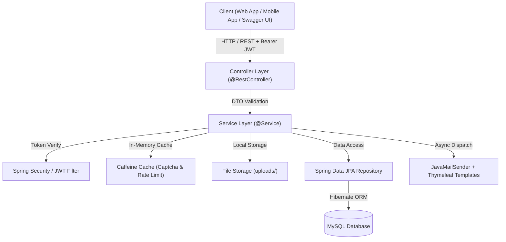
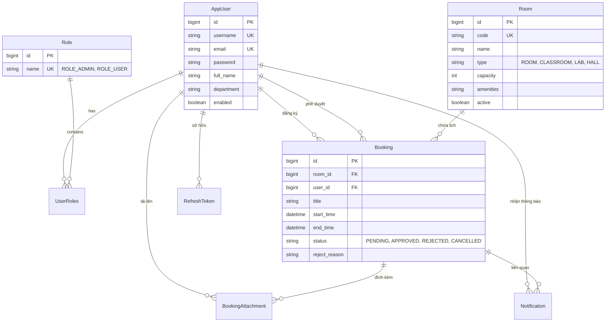
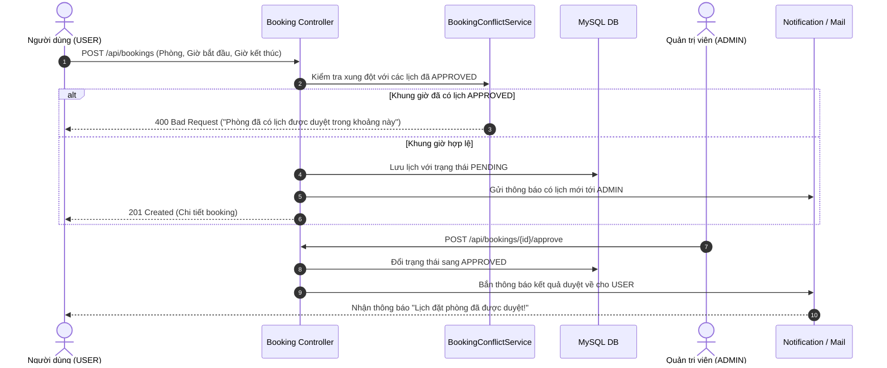

<div align="center">

# 🏢 Room Booking System - Backend RESTful API

[](https://openjdk.org/)
[](https://spring.io/projects/spring-boot)
[](https://spring.io/projects/spring-security)
[](https://www.mysql.com/)
[](http://localhost:8086/swagger-ui.html)
[](https://www.docker.com/)
[](LICENSE)

<p align="center">
  <b>Hệ thống quản lý đặt phòng họp thông minh, kiểm soát xung đột thời gian thực, quy trình phê duyệt chặt chẽ và tự động hóa thông báo.</b>
</p>

[Tính Năng](#-tính-năng-nổi-bật) •
[Kiến Trúc](#-kiến-trúc-hệ-thống) •
[Bắt Đầu Nhanh](#-bắt-đầu-nhanh-quick-start) •
[Docker](#-chạy-với-docker-compose) •
[API Docs](#-danh-mục-api-endpoints) •
[Đóng Góp](#-quy-trình-đóng-góp-git-flow)

</div>

---

## 📖 Giới Thiệu

**Room Booking System Backend** là giải pháp phần mềm quản lý phòng họp và hội trường tập trung dành cho trường học, tổ chức và doanh nghiệp. Hệ thống giải quyết triệt để tình trạng trùng lịch họp, tự động hóa khâu đăng ký - xét duyệt, đồng thời cung cấp bảng dữ liệu thống kê trực quan cho ban quản trị.

### ✨ Điểm nổi bật:
* 🛡️ **Bảo mật tối đa**: Xác thực JWT token kép với cơ chế **Token Rotation** và Captcha tích hợp chống tấn công tự động (brute-force).
* ⚡ **Kiểm tra xung đột tức thì**: Thuật toán quét trùng lịch theo thời gian thực (real-time conflict detection) ngay khi tạo hoặc dời lịch.
* 📅 **Lịch trình đa dạng**: Hỗ trợ xem lịch trình theo dòng thời gian (ngày, tuần, tháng).
* 📎 **Tệp đính kèm linh hoạt**: Cho phép tải lên tệp tài liệu cuộc họp (tối đa 20MB/file, 20 file/lịch) và ảnh phòng/avatar.
* 📬 **Thông báo tự động**: Thông báo in-app và gửi email tự động qua mẫu HTML Thymeleaf.

---

## 🏛️ Kiến Trúc Hệ Thống

### 1. Kiến trúc phân tầng (Layered Architecture)



### 2. Sơ đồ thực thể cơ sở dữ liệu (ERD)



### 3. Sơ đồ tuần tự: Luồng Đặt phòng & Duyệt phòng



---

## 🚀 Ngăn Xếp Công Nghệ (Tech Stack)

* **Ngôn ngữ**: [Java 21 LTS](https://www.oracle.com/java/technologies/downloads/#java21)
* **Framework**: [Spring Boot 4.x](https://spring.io/projects/spring-boot)
  * `spring-boot-starter-webmvc` (RESTful APIs)
  * `spring-boot-starter-security` (Phân quyền & bảo mật)
  * `spring-boot-starter-data-jpa` (Hibernate ORM & JPA Data Access)
  * `spring-boot-starter-validation` (Kiểm tra ràng buộc dữ liệu Bean Validation)
  * `spring-boot-starter-mail` & `spring-boot-starter-thymeleaf` (Gửi mail với giao diện HTML)
  * `spring-boot-starter-cache` & `caffeine` (Bộ nhớ đệm trong RAM)
* **Xác thực**: [JJWT (io.jsonwebtoken)](https://github.com/jwtk/jjwt) `0.12.6` (Ký và xác thực HMAC-SHA)
* **Cơ sở dữ liệu**: [MySQL 8.0+](https://www.mysql.com/)
* **Tài liệu API**: [SpringDoc OpenAPI 3](https://springdoc.org/) (Swagger UI)
* **Công cụ hỗ trợ**: Project Lombok, Maven Wrapper, Docker

---

## 🎯 Tính Năng Nổi Bật

<details>
<summary><b>1. Xác thực & Phân quyền (Auth & Security)</b> - <i>[Bấm để xem chi tiết]</i></summary>

* **Đăng ký / Đăng nhập kép**: Đăng nhập bằng `username` hoặc `email`.
* **Cơ chế Token kép (Dual Token)**:
  * **Access Token**: Sống 15 phút, dùng xác thực mỗi API request.
  * **Refresh Token**: Sống 7 ngày, áp dụng **Token Rotation** (mỗi lần refresh sẽ hủy token cũ và cấp token mới), chống replay attack.
* **Tạo Quản trị viên ban đầu**: Cho phép tạo tài khoản `ROLE_ADMIN` đầu tiên tự do qua `/api/auth/admin/register`. Từ admin thứ hai trở đi, chỉ Admin mới được tạo Admin.
* **Chống Brute-force**: Tích hợp phép tính toán học Captcha sinh ngẫu nhiên qua Caffeine Cache (hiệu lực 5 phút/lần dùng duy nhất).
* **Quên mật khẩu**: Gửi email chứa liên kết token đặt lại mật khẩu với thời hạn 15 phút.
</details>

<details>
<summary><b>2. Quản lý phòng họp (Room Management)</b> - <i>[Bấm để xem chi tiết]</i></summary>

* Thêm, sửa, xóa, tìm kiếm, phân trang danh mục phòng.
* Phân loại phòng: `ROOM` (Phòng họp), `CLASSROOM` (Phòng học), `LAB` (Phòng thí nghiệm), `HALL` (Hội trường lớn).
* Quản lý trạng thái: Khóa bảo trì hoặc mở hoạt động.
* Hỗ trợ lưu ảnh phòng qua link ngoài hoặc tải trực tiếp lên server.
</details>

<details>
<summary><b>3. Đặt phòng & Kiểm soát xung đột (Booking & Scheduling)</b> - <i>[Bấm để xem chi tiết]</i></summary>

* Đăng ký đặt phòng kèm tiêu đề, mục đích, số người, phòng và khung giờ.
* Tự động kiểm tra trùng giờ: Ngăn chặn tuyệt đối trùng lặp với các lịch đã `APPROVED`.
* Hỗ trợ tải lên tài liệu đính kèm cho cuộc họp (PDF, DOCX, XLSX, ZIP...).
* Xem lịch trực quan dạng Timeline (Ngày / Tuần / Tháng).
* Hỗ trợ **Dời lịch (Reschedule)** hoặc **Hủy lịch (Cancel)** theo chính sách nghiệp vụ.
</details>

<details>
<summary><b>4. Quy trình duyệt & Thông báo (Approval & Notification)</b> - <i>[Bấm để xem chi tiết]</i></summary>

* Quản trị viên duyệt (`APPROVED`) hoặc từ chối (`REJECTED`) kèm lý do giải thích.
* Tự động gửi thông báo in-app và email tức thời cho cả hai bên khi có thay đổi trạng thái.
</details>

<details>
<summary><b>5. Dashboard & Báo cáo thống kê (Dashboard)</b> - <i>[Bấm để xem chi tiết]</i></summary>

* **Admin Dashboard**: Thống kê số phòng, số lịch đặt, tỷ lệ lấp đầy phòng họp (%), biểu đồ trạng thái.
* **User Dashboard**: Thống kê cá nhân và danh sách cuộc họp sắp tới.
</details>

---

## 📁 Cấu Trúc Thư Mục Dự Án

```text
room-booking-system/
├── .github/                      # Cấu hình GitHub Actions / Hooks
├── .mvn/                         # Binary Maven Wrapper
├── uploads/                      # Lưu trữ tệp upload (avatars, rooms, bookings)
├── src/
│   ├── main/
│   │   ├── java/com/example/roombooking/
│   │   │   ├── config/           # Cấu hình Security, CORS, JWT, OpenAPI, Mail, Cache
│   │   │   ├── constant/         # Hằng số hệ thống (API paths, quy tắc booking, roles)
│   │   │   ├── controller/       # REST API Controllers (12 Controllers)
│   │   │   ├── dto/              # DTOs cho Request / Response
│   │   │   ├── entity/           # JPA Entities (AppUser, Role, Room, Booking, ...)
│   │   │   ├── exception/        # Global Exception Handler (@RestControllerAdvice)
│   │   │   ├── mapper/           # Chuyển đổi DTO <-> Entity
│   │   │   ├── repository/       # Spring Data JPA Repositories
│   │   │   ├── security/         # JWT Authentication Filter, EntryPoint
│   │   │   ├── service/          # Business Services & Implementations
│   │   │   ├── specification/    # JPA Specifications hỗ trợ lọc dữ liệu động
│   │   │   └── util/             # Tiện ích Date/Time, Token, File Storage, IP
│   │   └── resources/
│   │       ├── templates/email/  # Giao diện HTML email Thymeleaf
│   │       ├── application.properties      # Cấu hình chung
│   │       ├── application-dev.properties  # Cấu hình môi trường Dev
│   │       └── application-prod.properties # Cấu hình môi trường Production
│   └── test/                     # Unit & Integration Tests
├── .env.example                  # Mẫu khai báo biến môi trường
├── docker-compose.yml            # Khởi chạy toàn bộ hệ thống bằng Docker
├── Dockerfile                    # Docker multi-stage build JRE 21
├── mvnw / mvnw.cmd               # Maven Wrapper executable
├── pom.xml                       # Quản lý dependencies Maven
└── README.md                     # Tài liệu dự án
```

---

## ⚡ Bắt Đầu Nhanh (Quick Start)

### 1. Yêu cầu tiên quyết
* Đã cài đặt **JDK 21 LTS** (`java -version`).
* **MySQL 8.0+** đang chạy trên cổng `3306`.

### 2. Cài đặt & Cấu hình môi trường
Clone repo về máy và sao chép cấu hình:
```bash
git clone https://github.com/your-username/room-booking-system.git
cd room-booking-system

# Tạo file .env từ file mẫu
cp .env.example .env
```

> [!NOTE]
> Database `room_booking_db` sẽ **tự động được tạo trên MySQL** nhờ cờ `createDatabaseIfNotExist=true` trong chuỗi kết nối JDBC.

### 3. Khởi chạy ứng dụng

**Trên Windows (PowerShell / CMD):**
```powershell
.\mvnw.cmd spring-boot:run
```

**Trên Linux / macOS:**
```bash
chmod +x mvnw
./mvnw spring-boot:run
```

Khi ứng dụng chạy thành công, truy cập giao diện tài liệu API tại:
👉 **[http://localhost:8086/swagger-ui.html](http://localhost:8086/swagger-ui.html)**

---

## 🐳 Chạy Với Docker Compose

Nếu bạn đã cài sẵn Docker và Docker Compose, bạn có thể khởi chạy toàn bộ (MySQL + Backend) bằng 1 lệnh duy nhất:

```bash
docker compose up -d
```

* **Backend API**: `http://localhost:8086`
* **Swagger UI**: `http://localhost:8086/swagger-ui.html`
* **MySQL Port**: `3306` (Database: `room_booking_db`, user: `root`, pass: `root`)

Để dừng và xóa container:
```bash
docker compose down
```

---

## 🧪 Hướng Dẫn Thử Nghiệm API Trên Swagger (4 Bước)

```text
[1. Lấy Captcha] ──> [2. Tạo Admin Đầu Tiên] ──> [3. Đăng Nhập & Lấy Token] ──> [4. Authorize Swagger]
```

### Bước 1: Lấy mã Captcha
* Endpoint: `POST /api/auth/captcha`
* Response nhận được:
  ```json
  {
    "challengeId": "a988d446-24ea-4c91-a1e6-b9ee01509a25",
    "question": "25 + 17 = ?",
    "expiresInSeconds": 300
  }
  ```
  *(Kết quả câu hỏi là `42`)*.

### Bước 2: Tạo tài khoản Quản trị viên (Admin) đầu tiên
* Endpoint: `POST /api/auth/admin/register`
* Body mẫu:
  ```json
  {
    "username": "admin",
    "password": "Password123@",
    "email": "admin@roombooking.com",
    "fullName": "Quản Trị Viên Hệ Thống",
    "phoneNumber": "0987654321",
    "department": "IT Support",
    "captchaId": "a988d446-24ea-4c91-a1e6-b9ee01509a25",
    "captchaAnswer": "42"
  }
  ```

### Bước 3: Đăng nhập lấy Bearer Token
* Endpoint: `POST /api/auth/login`
* Điền `usernameOrEmail`: `admin`, `password`: `Password123@` (kèm Captcha mới).
* Nhận về chuỗi `accessToken`.

### Bước 4: Thiết lập Authorize trên Swagger UI
* Bấm nút **Authorize 🔓** ở góc trên bên phải màn hình Swagger UI.
* Nhập: `Bearer <accessToken_của_bạn>` rồi bấm **Authorize**.
* Giờ đây bạn có thể kiểm thử toàn bộ các API thêm phòng, đặt lịch, duyệt lịch mà không bị lỗi `401 Unauthorized`.

---

## 📋 Danh Mục API Endpoints

<details open>
<summary><b>1. Xác thực & Tài khoản (Authentication) - <code>/api/auth</code></b></summary>

| Method | Endpoint | Quyền hạn | Mô tả chức năng |
| :--- | :--- | :--- | :--- |
| `POST` | `/api/auth/captcha` | Public | Tạo phép tính Captcha |
| `POST` | `/api/auth/register` | Public | Đăng ký tài khoản người dùng (`ROLE_USER`) |
| `POST` | `/api/auth/admin/register` | Public / Admin | Đăng ký Admin (tự do với Admin đầu tiên) |
| `POST` | `/api/auth/login` | Public | Đăng nhập tài khoản |
| `POST` | `/api/auth/admin/login` | Public | Đăng nhập tài khoản Quản trị viên |
| `POST` | `/api/auth/refresh-token` | Public | Cấp mới Access Token (Token Rotation) |
| `POST` | `/api/auth/logout` | Authenticated | Đăng xuất và thu hồi Refresh Token |
| `POST` | `/api/auth/forgot-password`| Public | Gửi liên kết đặt lại mật khẩu qua email |
| `POST` | `/api/auth/verify-reset-token`| Public | Kiểm tra tính hợp lệ của mã đặt lại mật khẩu |
| `POST` | `/api/auth/reset-password` | Public | Đặt mật khẩu mới |
</details>

<details>
<summary><b>2. Quản lý phòng họp (Rooms) - <code>/api/rooms</code></b></summary>

| Method | Endpoint | Quyền hạn | Mô tả chức năng |
| :--- | :--- | :--- | :--- |
| `GET` | `/api/rooms` | Authenticated | Danh sách phòng họp (hỗ trợ phân trang, lọc) |
| `GET` | `/api/rooms/{id}` | Authenticated | Chi tiết phòng họp |
| `POST` | `/api/rooms` | `ROLE_ADMIN` | Thêm mới phòng họp |
| `PUT` | `/api/rooms/{id}` | `ROLE_ADMIN` | Cập nhật thông tin phòng họp |
| `DELETE` | `/api/rooms/{id}` | `ROLE_ADMIN` | Xóa phòng họp |
| `POST` | `/api/rooms/{id}/image`| `ROLE_ADMIN` | Tải lên hình ảnh cho phòng |
</details>

<details>
<summary><b>3. Đặt phòng & Lịch trình (Bookings) - <code>/api/bookings</code></b></summary>

| Method | Endpoint | Quyền hạn | Mô tả chức năng |
| :--- | :--- | :--- | :--- |
| `POST` | `/api/bookings` | Authenticated | Tạo yêu cầu đặt phòng họp |
| `GET` | `/api/bookings/my-bookings` | Authenticated | Danh sách lịch đặt phòng của người dùng hiện tại |
| `GET` | `/api/bookings` | `ROLE_ADMIN` | Toàn bộ danh sách lịch đặt phòng |
| `GET` | `/api/bookings/{id}` | Authenticated | Xem chi tiết lịch đặt phòng |
| `PUT` | `/api/bookings/{id}` | Authenticated | Chỉnh sửa lịch (khi đang `PENDING`) |
| `POST` | `/api/bookings/{id}/cancel` | Authenticated | Hủy lịch đặt phòng |
| `POST` | `/api/bookings/{id}/reschedule` | Authenticated | Dời lịch đặt sang khung giờ mới |
| `GET` | `/api/bookings/schedule` | Authenticated | Lịch phòng trực quan theo dòng thời gian |
| `POST` | `/api/bookings/{id}/approve` | `ROLE_ADMIN` | Phê duyệt yêu cầu đặt phòng |
| `POST` | `/api/bookings/{id}/reject` | `ROLE_ADMIN` | Từ chối yêu cầu đặt phòng |
</details>

<details>
<summary><b>4. Tài liệu đính kèm, Thông báo & Dashboard</b></summary>

| Method | Endpoint | Quyền hạn | Mô tả chức năng |
| :--- | :--- | :--- | :--- |
| `GET` | `/api/bookings/{id}/attachments` | Authenticated | Danh sách tệp đính kèm của cuộc họp |
| `POST` | `/api/bookings/{id}/attachments` | Authenticated | Tải lên tệp đính kèm (tối đa 20MB/file) |
| `DELETE`| `/api/bookings/{id}/attachments/{fileId}`| Authenticated | Xóa tệp đính kèm |
| `GET` | `/api/notifications` | Authenticated | Danh sách thông báo của người dùng |
| `PUT` | `/api/notifications/{id}/read` | Authenticated | Đánh dấu thông báo đã đọc |
| `GET` | `/api/dashboard/admin` | `ROLE_ADMIN` | Bảng thống kê tổng quan cho quản trị viên |
| `GET` | `/api/dashboard/user` | Authenticated | Bảng thống kê và lịch sắp tới của cá nhân |
| `GET` | `/api/profile` | Authenticated | Xem thông tin hồ sơ tài khoản |
| `PUT` | `/api/profile` | Authenticated | Cập nhật hồ sơ cá nhân |
| `POST` | `/api/profile/change-password` | Authenticated | Đổi mật khẩu |
</details>

---

## ⚙️ Quy Tắc Nghiệp Vụ Cốt Lõi

> [!IMPORTANT]
> * **Khung giờ hoạt động**: Chỉ cho phép đặt phòng trong khoảng thời gian từ **06:00 đến 22:00**.
> * **Thời lượng đặt phòng**: Tối thiểu **30 phút**, tối đa **12 giờ**. Cho phép đặt trước tối đa **365 ngày**.
> * **Chiếm chỗ & Xung đột**: Chỉ các lịch có trạng thái `APPROVED` mới chính thức giữ chỗ và chặn khung giờ. Hai lịch họp bị coi là xung đột khi thời gian của chúng giao thoa tại cùng một phòng.
> * **Quy định tệp đính kèm**:
>   * Ảnh đại diện / Ảnh phòng: Tối đa **5 MB** (`jpg`, `jpeg`, `png`, `webp`, `gif`).
>   * Tài liệu cuộc họp: Tối đa **20 MB/tệp**, tối đa **20 tệp/cuộc họp** (`pdf`, `doc`, `docx`, `xls`, `xlsx`, `ppt`, `pptx`, `zip`...).

---

## 🛠️ Xử Lý Sự Cố Thường Gặp (FAQ)

<details>
<summary><b>1. Không kết nối được MySQL (Communications link failure / Access denied)?</b></summary>

* Hãy chắc chắn MySQL Server đang bật trên cổng `3306`.
* Kiểm tra `DB_USERNAME` và `DB_PASSWORD` trong file `.env` hoặc `application.properties`.
</details>

<details>
<summary><b>2. Lỗi cổng 8086 đã bị chiếm dụng (Port 8086 was already in use)?</b></summary>

* Đổi cổng bằng biến `SERVER_PORT=8087` trong `.env`.
* Hoặc giải phóng cổng trên PowerShell:
  ```powershell
  Get-Process -Id (Get-NetTCPConnection -LocalPort 8086).OwningProcess | Stop-Process -Force
  ```
</details>

<details>
<summary><b>3. Bị lỗi 401 Unauthorized khi gọi API trên Swagger?</b></summary>

* Kiểm tra đã bấm nút **Authorize** và nhập đúng định dạng: `Bearer <access_token>` hay chưa.
* Nếu token hết hạn (sau 15 phút), gọi API `/api/auth/refresh-token` với `refreshToken` để lấy token mới.
</details>

---

## 🤝 Quy Trình Đóng Góp (Git Flow)

Chúng tôi luôn hoan nghênh sự đóng góp của cộng đồng! Hãy tuân thủ quy trình sau:

1. **Fork** repository này về tài khoản của bạn.
2. Tạo nhánh tính năng mới:
   ```bash
   git checkout -b feature/ten-tinh-nang-moi
   ```
3. Commit các thay đổi theo chuẩn **Conventional Commits**:
   ```bash
   git commit -m "feat: bổ sung tính năng xuất lịch họp ra Google Calendar"
   ```
4. Đẩy nhánh lên GitHub:
   ```bash
   git push origin feature/ten-tinh-nang-moi
   ```
5. Mở một **Pull Request** trên GitHub kèm mô tả chi tiết các thay đổi.

---

## 📄 Bản Quyền & Giấy Phép (License)

Dự án được phân phối dưới giấy phép **MIT License**. Xem chi tiết tại file [LICENSE](LICENSE).

<div align="center">
  <sub>Được phát triển với đam mê và tâm huyết dành cho cộng đồng lập trình Java / Spring Boot.</sub>
</div>
